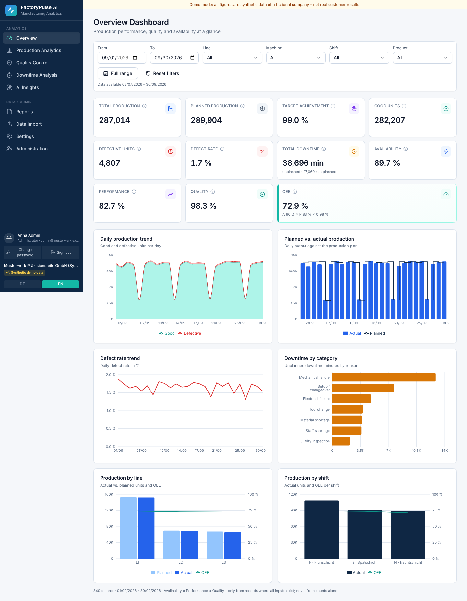

# FactoryPulse AI

**Manufacturing analytics & reporting platform for small and medium-sized manufacturers.**
FactoryPulse AI replaces Excel-based production reporting. It imports production, downtime and quality data from CSV/XLSX files, validates and normalizes the data, calculates manufacturing KPIs (including OEE), flags statistical anomalies and generates PDF/Excel management reports. The interface is available in German and English.

> **Demo data notice:** The bundled dataset is **synthetic**. The company in it, *Musterwerk Präzisionsteile GmbH*, is fictional. Every view and report built from demo data is labelled as synthetic. None of these figures are real customer results.



## Features

| Area | What works |
|---|---|
| Overview Dashboard | 11 KPI cards (production, plan, target achievement, good/defective units, defect rate, downtime, availability, performance, quality, OEE) and 6 charts. Filters for date range, line, machine, shift and product. |
| Production Analytics | Comparison with the previous period, grouping by day/week/shift/machine/line/product, a productivity trend, and a sortable/searchable table with CSV/Excel export. |
| Quality Control | Defect rate trend, defect Pareto (count, share, cumulative %), and defects by machine, line, product and shift. |
| Downtime Analysis | Downtime Pareto by reason, downtime by machine/line/shift, a stacked trend, a paginated event table, and automatic highlighting of machines with unusually high downtime (Tukey fence). |
| AI Insights | Transparent rolling robust z-score anomaly detection; Isolation Forest is optional. Thresholds are configurable. Each finding comes with an explanation and a chart. The demo data includes an injected ground truth that the detector is validated against. |
| Action Center | Investigations for operational issues (equipment failure, production loss, quality, downtime, process deviation, administrative safety observations). Server-enforced workflow (Open → In progress → Pending verification → Resolved → Closed / Reopened). Multiple corrective actions per investigation with owners, deadlines, completion notes and effectiveness verification. Activity timeline, comments, private evidence files (PDF/PNG/JPEG/CSV/XLSX), and a before/after KPI comparison labelled as *observed, not causal*. "Create investigation" from an AI Insights anomaly with a frozen evidence snapshot and duplicate protection. Configurable rule alerts, a dashboard with KPIs and charts, and *My Actions*. |
| Reports | Daily, weekly and monthly production reports plus quality and downtime reports, as PDF (WeasyPrint) or Excel (native charts), in German or English. A report history lets you download again. |
| Data Import | Drag & drop, preview, automatic column mapping (DE/EN headers), 20+ validation rules, review before import, transactional commit, duplicate protection, revert, and an audit trail. |
| Settings | Company name, default report language, anomaly defaults, Action Center alert rules, KPI definitions, system info. |
| Administration | Users and roles (viewer/analyst/admin), account lockout handling, backups (create/download/restore with safety backup), system readiness checks, data tools (re-authentication required), and an audit log showing who did what. |

## Quick start (Docker Compose)

Requirements: Docker 24+ with the Compose plugin.

```bash
cp .env.example .env          # set POSTGRES_PASSWORD and FP_INITIAL_ADMIN_EMAIL / FP_INITIAL_ADMIN_PASSWORD
docker compose up -d --build  # single workstation: http://localhost:8080
ops/verify.sh                 # deployment verification (see docs/OPERATIONS.md)
```

**Several users in the plant network: use the HTTPS mode and follow [docs/INSTALLATION.md](docs/INSTALLATION.md)**
(certificate, malware scanner, works council / GDPR checklist):

```bash
ops/generate-tls-cert.sh factorypulse.werk.local     # or a certificate from the company PKI in ./tls
docker compose -f docker-compose.yml -f docker-compose.lan.yml up -d --build
```

Open **http://localhost:8080** and sign in as the initial administrator. You must replace the temporary password at the first sign-in. After that, remove `FP_INITIAL_ADMIN_PASSWORD` from `.env` and create further users under **Administration → Users & roles**.

On first start the backend applies the Alembic migrations. A **production** installation (`FP_ENVIRONMENT=production`, the default) never loads synthetic data. With `FP_ENVIRONMENT=demo` (or the explicit opt-in `FP_SEED_DEMO_ON_STARTUP=true`), an empty database receives the 90-day synthetic demo dataset once. The API docs (Swagger) are at http://localhost:8080/api/docs.

There are **no default credentials**. If no initial admin is configured, create one with:
`docker compose exec backend python -m app.cli create-user --email you@firma.de --role admin`.

Services: `db` (PostgreSQL 16, not exposed), `backend` (FastAPI on :8000, internal), `worker` (scheduled alert evaluation and evidence re-scans), `frontend` (nginx serving the React build and proxying `/api`, HTTPS in LAN mode), optional `clamav`. Uploaded files, reports and evidence are stored in the private volume `app-data`.

> **Verification status (v0.3.1):** the Compose stack was built and run with Docker. That covers a fresh HTTPS installation, an upgrade of a v0.3.0 installation with existing data, three concurrent workers, ClamAV, backup and restore. Because the sandbox blocks Docker Hub, the base images were locally built Ubuntu 24.04 stand-ins with the same software versions. See [docs/DEPLOYMENT_VERIFICATION.md](docs/DEPLOYMENT_VERIFICATION.md) for what was and was not verified.

## Local development (without Docker)

Requirements: Python 3.12+, Node 20+ (tested with 22), PostgreSQL 14+ (16 recommended).

```bash
# 1. Database
createuser -P factorypulse            # choose a password
createdb -O factorypulse factorypulse

# 2. Backend
cd backend
python -m venv .venv && source .venv/bin/activate
pip install -r requirements-dev.txt
export FP_DATABASE_URL=postgresql+psycopg://factorypulse:<password>@localhost:5432/factorypulse
alembic upgrade head
python -m app.cli create-user --email admin@example.com --role admin --no-force-change   # prompts for a password
uvicorn app.main:app --reload --port 8000     # seeds demo data on first start
python -m app.worker                          # second terminal: scheduled alert rules / evidence scans

# 3. Frontend (second terminal)
cd frontend
npm ci
npm run dev                                   # http://localhost:5173 (proxies /api to :8000)
```

WeasyPrint needs Pango installed on the host. On Debian/Ubuntu: `apt install libpango-1.0-0 libpangoft2-1.0-0`. On macOS: `brew install pango`.

## Tests

| Suite | Command | Scope |
|---|---|---|
| Backend (pytest, 216 tests) | `cd backend && FP_TEST_DATABASE_URL=postgresql+psycopg://factorypulse:<pw>@localhost:5432/factorypulse_test pytest` | KPI formulas (hand-calculated), import validation, duplicate protection, transactions, exports and formula injection, anomaly detection against injected ground truth, all 10 report variants. Security: every route requires authentication and declares a permission, a role matrix, CSRF, lockout and rate limiting, session expiry and revocation, re-authentication for destructive actions, and a backup → restore round trip with tamper detection. Action Center: creation, workflow transitions and audit, permissions per role and object, corrective actions and verification, deadlines and overdue logic, anomaly-to-investigation with snapshot and duplicate prevention, comment/evidence authorization, attachment validation, KPI before/after vs. the KPI engine, insufficient data, alert rule deduplication, DE/EN prefill, and backup/restore and demo reset including evidence. v0.3.1: production never seeds demo data (fresh-process start-up tests), injectable clock with UTC-midnight, year-boundary and Europe/Berlin DST tests (also run with the host in `TZ=Pacific/Kiritimati`), scheduled alert worker (read-only dashboard, deduplication, acknowledgement, automatic resolution, retries, rollback, concurrent runs), DB-side list/summary with 50,000 investigations and German Unicode search, evidence quarantine with a fake scanner, a fake clamd and – optionally (`FP_TEST_CLAMD`, `FP_TEST_CLAMSCAN`) – a real ClamAV, and static checks of the compose/nginx configuration. v0.3.3: explicit scanner health check and outage/recovery (a zero-work scan run never clears an outage), exhausted-retry reporting, and database/filesystem consistency under simulated commit failures, worker crashes, failed file moves and restores (`test_evidence_reliability.py`). Creates the schema through the Alembic migrations. Without `FP_TEST_DATABASE_URL` it falls back to SQLite. |
| Frontend unit (Vitest, 20 tests) | `cd frontend && npm test` | Number/percent formatting (de/en), N/A handling, filters, i18n completeness, table sorting, KPI card, Action Center filters, alert texts and DE/EN labels, scan-status badges and alert-freshness texts. |
| End-to-end (Playwright, 24 tests) | `cd frontend && npx playwright install chromium && npm run test:e2e` | Login/logout, forced password change, viewer/analyst/admin access, administration (users, system status, audit, backup, re-authentication), navigation, filters, German UI, CSV import and revert, invalid file, anomaly detection, PDF/Excel download, downtime highlight, exports. Action Center: overview KPIs vs. API, manual creation and assignment, the analyst flow from anomaly → investigation → actions → verification → resolved, duplicate prevention, comments, evidence upload/rejection/download, KPI comparison including N/A, My Actions, viewer read-only, and direct API rejection for viewer, analyst and anonymous users, alert-worker status and *Evaluate now*, the evidence scanner card (*Check scanner now*, *Reconcile files*), and evidence scanning (clean/infected with a scanner, or quarantine and admin release without one). Needs `E2E_ADMIN_EMAIL`, `E2E_ANALYST_EMAIL`, `E2E_VIEWER_EMAIL` and `E2E_PASSWORD` for existing accounts. **Resets the database to demo data**, so it requires `FP_ENABLE_DEMO_TOOLS=true`. Set `E2E_BASE_URL=http://localhost:8080` to test the Docker stack. |

## Importing your own data

1. **Data Import → Download template** (XLSX or CSV), or use your existing export.
2. Drop the file. Columns are mapped automatically using German or English synonyms, e.g. `Datum`, `Maschine`, `Istmenge`, `Ausschuss`, `Stillstandszeit`, `Taktzeit`. Adjust the mapping if needed.
3. **Validate.** Review the errors and warnings, broken down by row and column.
4. **Import.** If the file contains errors, the import is blocked unless you explicitly choose to import only the valid rows.

Sample files (synthetic) are in [`sample_data/`](sample_data):

- `sample_import_valid_de.csv`: German format (semicolon separator, decimal comma, `DD.MM.YYYY` dates), 1–7 Oct 2026
- `sample_import_valid_en.xlsx`: English headers, 8–14 Oct 2026
- `sample_import_with_errors.csv`: deliberate errors covering every validation category

The minimum required columns are Date, Line, Machine, Shift, Product and Actual Quantity. Fields you don't provide stay **empty (N/A)** and are never replaced with zero. OEE is shown only for records that contain planned production time, operating time, ideal cycle time and good quantity.

## Documentation

- [Architecture](docs/ARCHITECTURE.md)
- [KPI definitions & formulas](docs/KPI_DEFINITIONS.md)
- [API reference](docs/API.md) (+ [OpenAPI spec](docs/openapi.json), live at `/api/docs`)
- [Security & privacy, including known limitations](docs/SECURITY.md)
- [Secure installation for a customer (HTTPS LAN, scanner, works council, GDPR)](docs/INSTALLATION.md)
- [Operations: users, backup/restore, deployment verification, worker, upgrades](docs/OPERATIONS.md)
- [Deployment verification results v0.3.1](docs/DEPLOYMENT_VERIFICATION.md)
- [Changelog](CHANGELOG.md)
- [Screenshots](docs/screenshots) (EN and `_de` variants)
- [Sample reports](docs/sample_reports) (synthetic: German monthly PDF, English monthly Excel, Q3 downtime PDF)

## Known limitations (MVP)

- **Authentication:** local accounts only. There is no SSO, MFA or self-service password reset yet (see [SECURITY.md](docs/SECURITY.md)). HTTPS is built in for LAN installations (`docker-compose.lan.yml`); certificates are not renewed automatically.
- **Single company.** The schema includes `company_id` everywhere, but tenant isolation is not implemented. This is not a multi-tenant system.
- **No scheduled reports.** Reports are generated on demand. There is no email delivery.
- **No live machine connectivity** (OPC UA / MQTT). Data arrives only through file import.
- **Anomaly detection** finds statistical deviations. It does not perform root-cause analysis and does not predict failures.
- **Action Center:** alerts are shown in the app only, with no e-mail/SMS. The KPI comparison shows observed differences and does not prove that an action caused them. Safety observations are administrative records, not a certified safety-management system. Alerts are refreshed by the worker every 5 minutes (not instantly). Malware scanning needs a configured scanner (ClamAV container or CLI); without one, evidence stays quarantined until an administrator releases it.
- One row per date × machine × shift × product. Each row carries a single downtime reason and a single defect category. More detailed event-level imports are a roadmap item.
